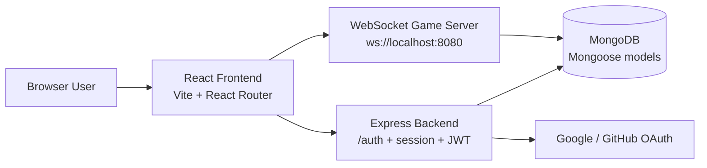

# PawnHub — Online Multiplayer Chess

PawnHub is a full-stack chess application built to let players join a browser-based chess match, make moves in real time, and compete against another human opponent through a live multiplayer flow. The project demonstrates a practical Full Stack Development setup with a React frontend, an Express API, a dedicated WebSocket game server, and a MongoDB-backed data layer.

## Project information

- Project: PawnHub
- Type: Full-stack chess application
- Focus: Browser-based online multiplayer chess gameplay
- Course / coursework: Full Stack Development project

## Features

### Implemented features

- Interactive chessboard UI with move validation and legal-move enforcement via `chess.js`
- Sign-in options for Google OAuth, GitHub OAuth, and guest login
- Create a new random game and join an existing room by game ID
- Real-time multiplayer communication through a dedicated WebSocket server
- Match state synchronization between players using game events and board payloads
- Move history, timers, and result handling for completed or abandoned matches
- Responsive single-page interface with theme switching
- User records and game records stored in MongoDB using Mongoose models

### Data model features present in code

- User model includes `username`, `name`, `email`, `provider`, and `rating`
- Game model stores players, status, result, move list, start/end timestamps, and FEN state
- Game move documents track `from`, `to`, `before`, `after`, `san`, and timing values

### Planned or not fully implemented in the current UI

- A dedicated leaderboard or player ranking dashboard is not implemented in the frontend
- A full game history / match archive screen is not present in the current routes
- Redis-based queue or background processing is referenced in environment examples but does not appear to be integrated in the current application runtime
- The native Expo app under `apps/native` appears to be a separate experimental/mobile app and is not the main browser-based game flow

## Screenshots

The repository currently includes a static chessboard image in the frontend assets, but it is not a full application capture. Add real screenshots in the project documentation before publishing the README more broadly.

Suggested placeholder locations:

- `docs/screenshots/home.png`
- `docs/screenshots/chessboard.png`
- `docs/screenshots/login.png`

Current image asset present in the repo:

- `apps/frontend/public/chessboard.jpeg`

This asset can be used as a temporary visual placeholder, but it should not be described as a finished application screenshot unless it is explicitly updated later.

## Technology stack

### Frontend

- React 18 — main client-side interface
- TypeScript — typed application logic for the browser app
- Vite — development server and production bundling
- React Router — route handling for landing, login, settings, and games
- Tailwind CSS — utility-first styling
- Recoil + Zustand — client state and board state management
- `chess.js` — chess rules, move validation, check/checkmate detection, and FEN updates
- Radix UI and Lucide icons — interface primitives and iconography

### Backend

- Node.js — JavaScript runtime for the API server
- Express.js — HTTP server and middleware layer
- Passport.js — OAuth authentication flow for Google and GitHub
- JWT — signed guest/session-style tokens for auth-driven gameplay
- CORS + cookie/session middleware — browser session handling
- Mongoose + MongoDB — user and game persistence

### Real-time game server

- `ws` (WebSocket library) — live multiplayer connection layer
- `chess.js` — move validation and game-state tracking on the server side
- MongoDB — stores ongoing and completed game records and move history

### Shared tooling

- Turbo repo — workspace orchestration for the monorepo
- TypeScript project references and shared config packages — common build and lint settings

### Note on Redis

The repo includes `REDIS_URL` in the environment examples, but no active Redis client or queue implementation was found in the current application code. The live app currently appears to rely on MongoDB plus WebSocket communication rather than a Redis-backed queue.

## Application architecture



### How the architecture works

- The frontend is responsible for rendering the chess board, login flow, theme switching, and game screen experience.
- The Express backend handles authentication endpoints such as `/auth/google`, `/auth/github`, and `/auth/guest`, and it also initializes Passport and session management.
- The WebSocket server handles multiplayer game room setup, move broadcasts, room joining, and match completion signals.
- MongoDB stores user records and game records, including the move list and current FEN state.
- HTTP requests are used mainly for authentication and bootstrapping; real-time gameplay is delivered through WebSocket events instead of repeated polling.

## Project structure

```text
chess/
├── .env.example                  # Root environment template
├── .env                          # Local environment file (if present)
├── package.json                  # Root workspace config and scripts
├── yarn.lock                     # Yarn lockfile
├── turbo.json                    # Turbo repo configuration
├── tsconfig.json                 # Shared TypeScript config
├── apps/
│   ├── backend/                  # Express API + Passport auth server
│   │   ├── src/
│   │   ├── package.json
│   │   └── tsconfig.json
│   ├── frontend/                 # React/Vite browser client
│   │   ├── src/
│   │   ├── public/
│   │   ├── package.json
│   │   └── README.md
│   ├── native/                   # Expo/React Native app (separate from main browser app)
│   │   ├── app/
│   │   ├── package.json
│   │   └── package-lock.json
│   └── ws/                       # WebSocket multiplayer game server
│       ├── src/
│       └── package.json
├── packages/
│   ├── db/                       # Shared MongoDB/Mongoose models and connection
│   ├── store/                    # Shared Recoil state atoms and hooks
│   ├── tailwind-Config/
│   ├── ui/                       # Shared UI building blocks
│   ├── eslint-config/
│   └── typescript-config/
├── node_modules/                 # Installed dependencies
└── .gitignore
```

### Important directories

- `apps/frontend` — browser client for login, landing page, board interactions, route handling, and theme UI
- `apps/backend` — API server for auth, sessions, JWT issuance, and backend bootstrap
- `apps/ws` — real-time game engine for room creation, joins, moves, time tracking, and match completion
- `packages/db` — central database schema and MongoDB connection helper
- `packages/store` — Recoil-based shared state for user and chess gameplay data
- `packages/ui` — reusable UI components used across the app

## Prerequisites

The current codebase expects the following runtime dependencies:

- Node.js 18 or newer
- Yarn 1.x
- MongoDB running locally
- Optional / legacy: Redis, based on sample environment values
- OAuth credentials for Google and GitHub if you want to enable those providers

### Windows-friendly notes

- Install Node.js from the official Node.js installer and reopen the terminal after installation.
- MongoDB can be started by running `mongod` in a terminal or through the MongoDB service on your machine.
- Keep a separate terminal open for each app service when running the project in development mode.

## Installation and setup

### 1. Clone the repository

```bash
git clone <repository-url>
cd chess
```

### 2. Install dependencies

```bash
yarn install
```

### 3. Configure environment variables

Copy the root example file and update it with your local values:

```bash
cp .env.example .env
```

The project also includes database package examples under `packages/db/.env.example`, but the active app configuration is driven from the root `.env` file used by the backend and shared connection layer.

### 4. Start MongoDB

Make sure MongoDB is running before starting the backend or WebSocket server.

```bash
mongod
```

If MongoDB is running as a Windows service, start the service instead.

### 5. Start the backend API

Open a terminal and run:

```bash
cd apps/backend
yarn dev
```

This starts the Express app and binds it to the port in `PORT` (default: `3000`).

### 6. Start the WebSocket game server

Open a second terminal and run:

```bash
cd apps/ws
yarn dev
```

This starts the WebSocket server on the port in `WS_PORT` (default: `8080`).

### 7. Start the frontend

Open a third terminal and run:

```bash
cd apps/frontend
yarn dev
```

The frontend development server runs on:

```text
http://localhost:5173
```

### 8. Open the app in your browser

Visit:

```text
http://localhost:5173
```

If you sign in as a guest, the app creates a guest user record and sends you to the game flow. OAuth-based login requires the Google and/or GitHub credentials to be configured in the environment.

## Environment variables

The app reads its configuration from environment variables defined in the repository root `.env` file. The values below reflect the current source code and configuration files.

| Variable | Required | Used by | Purpose | Example |
| --- | --- | --- | --- | --- |
| `PORT` | Yes | Backend | HTTP server port | `3000` |
| `WS_PORT` | Yes | WebSocket server | WebSocket server port | `8080` |
| `JWT_SECRET` | Yes | Backend | Signs JWT-based auth tokens | `CHANGE_ME` |
| `COOKIE_SECRET` | Yes | Backend | Express session cookie signing | `CHANGE_ME` |
| `MONGODB_URI` | Yes | Backend + WS + shared DB layer | MongoDB connection string | `mongodb://127.0.0.1:27017/chess` |
| `REDIS_URL` | Optional / legacy | sample environment only | Listed in examples, but no active implementation found in app code | `redis://127.0.0.1:6379` |
| `ALLOWED_HOSTS` | Yes | Backend CORS | Allowed origin list for browser requests | `http://localhost:5173` |
| `AUTH_REDIRECT_URL` | Yes | Backend auth redirect flow | Redirect target after OAuth or guest auth | `http://localhost:5173/game/random` |
| `GOOGLE_CLIENT_ID` | Optional | Backend Passport | Google OAuth client ID | `your_google_client_id` |
| `GOOGLE_CLIENT_SECRET` | Optional | Backend Passport | Google OAuth client secret | `your_google_client_secret` |
| `GITHUB_CLIENT_ID` | Optional | Backend Passport | GitHub OAuth client ID | `your_github_client_id` |
| `GITHUB_CLIENT_SECRET` | Optional | Backend Passport | GitHub OAuth client secret | `your_github_client_secret` |
| `VITE_APP_WS_URL` | Yes for browser client | Frontend | WebSocket URL used by the browser client | `ws://localhost:8080` |
| `VITE_APP_BACKEND_URL` | Yes for browser client | Frontend | Backend API base URL | `http://localhost:3000` |
| `VITE_APP_REDIRECT_URL` | Optional | Frontend auth flow | Redirect target for browser-based auth | `http://localhost:5173/game/random` |

### Notes on config

- Google or GitHub login will be skipped if the corresponding client ID / secret values are missing.
- The app still starts without OAuth credentials, but the authentication buttons will be unavailable or will return a 503-style configuration error.
- The frontend can fall back to `http://localhost:3000` and `ws://localhost:8080` when environment values are absent.

## Running the project as a team / full stack

This repository is structured as a monorepo, but the browser game still depends on the services working together:

1. MongoDB must be available.
2. The backend API must be running.
3. The WebSocket server must be running.
4. The React frontend must be running.

The gameplay is stored and synchronized through the database and the live WebSocket channel rather than by polling the server repeatedly.

## Tests and validation

The current repository does not include a dedicated automated test suite or runner such as Jest, Vitest, or Cypress in the application packages. Build and lint commands that are present in the source are:

- Root workspace: `yarn build`, `yarn lint`
- Frontend app: `cd apps/frontend && yarn build`, `yarn lint`
- Backend app: `cd apps/backend && yarn build`, `yarn lint`
- WebSocket app: `cd apps/ws && yarn build`, `yarn lint`

## Contributing

This repository is structured as a project workspace with a shared UI/store/database setup. Most of the user-facing logic is in `apps/frontend`, while the game engine and persistence live in `apps/ws` and `packages/db`.

## License

No explicit root license file is present in the repository at the time of this review. If this repository is intended for distribution or reuse beyond the local project context, confirm the project’s licensing terms before publishing or sharing it externally.
